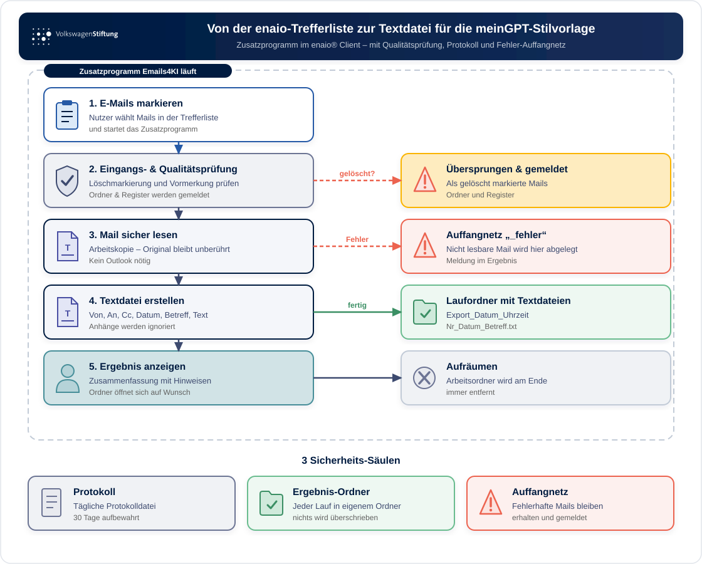
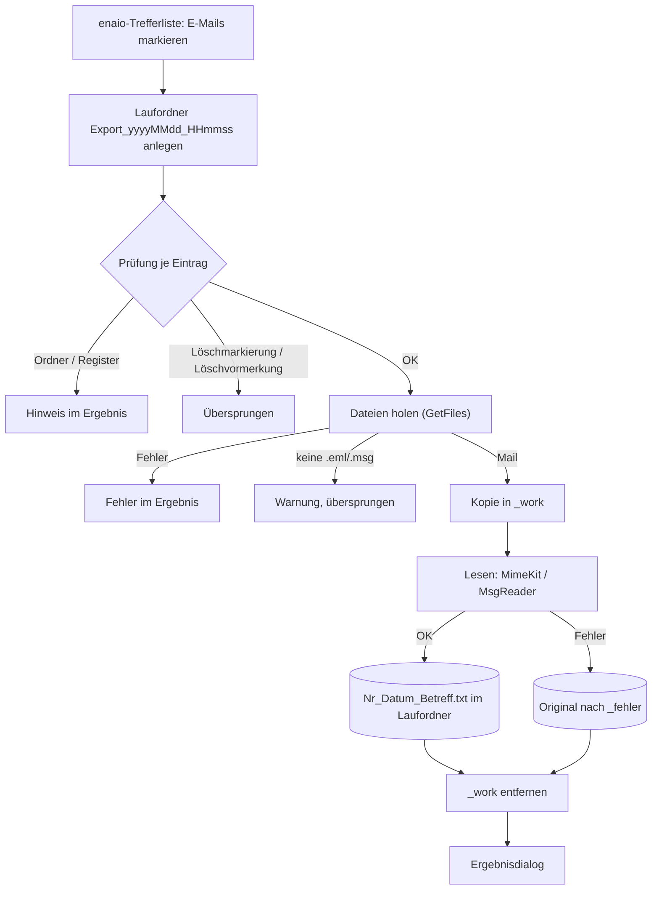

# Emails4KI

**Emails4KI** ist ein Zusatzprogramm für den **enaio® Client** (.NET 10 WinForms). Es exportiert die in der Trefferliste markierten E-Mails (`.eml` / `.msg`) und wandelt sie in UTF-8-Textdateien um. Die Texte dienen als Stilvorlage für einen Skill in der meinGPT-Plattform.

## Anleitungen

| Zielgruppe | HTML | Markdown | Word |
|---|---|---|---|
| Anwender (Fachbereich) | [HTML](docs/Anleitung_Anwender.html) | [MD](docs/Anleitung_Anwender.md) | [DOCX](docs/Anleitung_Anwender.docx) |
| IT & Betrieb | [HTML](docs/Anleitung_IT.html) | [MD](docs/Anleitung_IT.md) | [DOCX](docs/Anleitung_IT.docx) |

## Grafischer Programmablauf






```text
enaio-Trefferliste
        |
        v
%USERPROFILE%\Downloads\enaio_export\
  \-- Export_yyyyMMdd_HHmmss\     <- Laufordner
        |-- _work\                <- Arbeitskopien (wird immer entfernt)
        |-- _fehler\              <- nicht konvertierbare Originale
        \-- 0001_20250307_Betreff.txt   <- Ergebnis (UTF-8)

%LOCALAPPDATA%\Emails4KI\Logs\Emails4KI-JJJJ-MM-TT.log   <- Protokoll (30 Tage)
```
## Ablauf

1. Der Nutzer markiert E-Mails in der enaio-Trefferliste und startet das Zusatzprogramm.
2. Pro Programmlauf entsteht ein Ordner `<ExportPath>\Export_yyyyMMdd_HHmmss` (Muster über `RunFolderPattern`).
3. Je Eintrag werden geprüft: Ordner/Register (werden gemeldet und übersprungen), fachliche Löschmarkierung (`zahl1`, je Objekttyp abweichend konfigurierbar) und enaio-Löschvormerkung.
4. Die Mail wird in den Arbeitsordner `_work` kopiert und dort gelesen (`.eml` über MimeKit, `.msg` über MsgReader – kein Outlook nötig).
5. Ergebnis: `Nr_Datum_Betreff.txt` (z. B. `0001_20250307_Grüße aus Köln.txt`) mit Von, An, Cc, Datum, Betreff und Textkörper (HTML wird zu Text), UTF-8 (standardmäßig mit BOM). Anhänge werden ignoriert.
6. Die Original-Mail im Arbeitsordner wird gelöscht. Schlägt die Konvertierung fehl, wird das Original nach `_fehler` verschoben und im Ergebnisdialog gemeldet. `_work` wird am Ende immer entfernt.

## Projektstruktur

- `Emails4KI.sln` / `Emails4KI.csproj` – Hauptprojekt (.NET 10 Windows / WinForms)
- `MailToTextConverter.cs` – Einlesen von eml/msg und Textformatierung
- `ExportRunner.cs` – Ablaufsteuerung (Laufordner, Prüfungen, Konvertierung, Fehlerordner)
- `Emails4KI.json` – Konfiguration (Umgebungsvariablen-Präfix: `EMAILS4KI_`)
- `tests/Emails4KI.Tests/` – Automatisierte Tests

## Konfiguration (`Emails4KI.json`)

Alle Werte können über Umgebungsvariablen mit dem Präfix `EMAILS4KI_` überschrieben werden (z. B. `EMAILS4KI_FileLogging__Directory`).

| Schlüssel | Bedeutung |
|---|---|
| `ExportPath` | Basisordner für die Laufordner |
| `RunFolderPattern` | Datumsmuster des Laufordners |
| `DeleteFlagField` | Löschfeld der E-Mail-Objekte (Standard `zahl1`) |
| `DeleteFlagFieldByType` | Abweichendes Löschfeld je Objekttyp-ID, z. B. für weitere Archive |
| `CheckSystemDeleteFlag` | enaio-Löschvormerkung prüfen |
| `MaxFileNameLength` | Maximale Dateinamenlänge |
| `Utf8Bom` | Textdateien mit UTF-8-BOM schreiben |
| `AutoOpenExportFolders` | Laufordner nach dem Export im Explorer öffnen |

- **Standard-Logverzeichnis:** `%LOCALAPPDATA%\Emails4KI\Logs`
- **Logdatei:** `Emails4KI-JJJJ-MM-TT.log` (Aufbewahrung standardmäßig 30 Tage)

## Build & Tests

```powershell
dotnet build Emails4KI.sln -c Release
dotnet run --project tests\Emails4KI.Tests\Emails4KI.Tests.csproj -c Release
```
