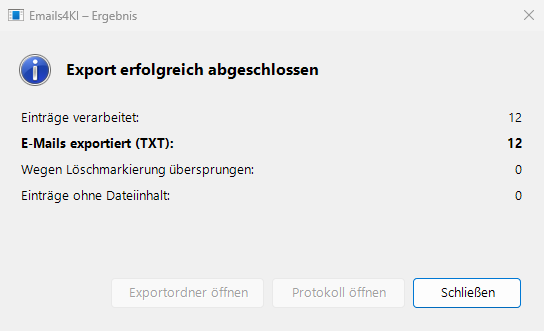
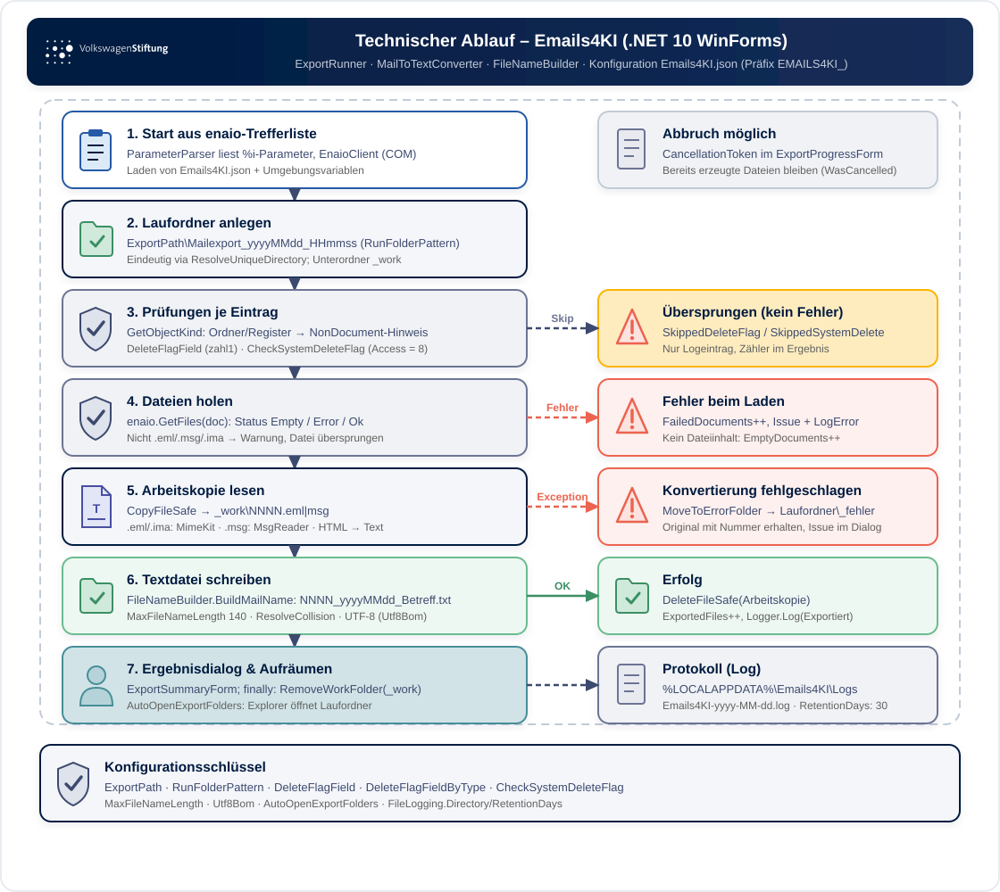
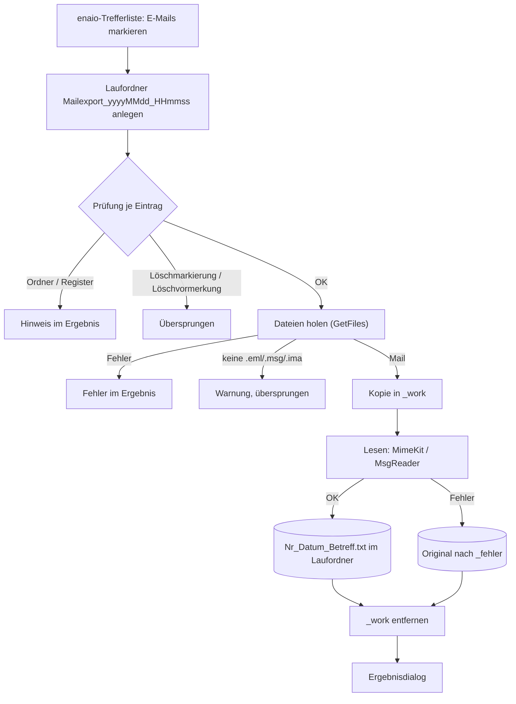

# Emails4KI

**Emails4KI** ist ein Zusatzprogramm für den **enaio® Client** (.NET 10, WinForms). Es exportiert die in der Trefferliste markierten E-Mails (`.eml` / `.msg` / `.ima`) und wandelt sie in schlanke **UTF-8-Textdateien** um. Die Texte dienen als Stilvorlage für einen Skill in der **meinGPT-Plattform**.

## Auf einen Blick

| | |
|---|---|
| **Zweck** | E-Mails aus enaio als reinen Text bereitstellen (Kopfzeilen + Textkörper) |
| **Eingabe** | Markierte Objekte der enaio-Trefferliste (Übergabe als `%i`-Parameter) |
| **Ausgabe** | Pro Mail eine Datei `Nr_Datum_Betreff.txt` im Laufordner `Mailexport_yyyyMMdd_HHmmss` |
| **Formate** | `.eml` und `.ima` (ältere enaio-Mails, MimeKit), `.msg` (MsgReader) – **kein Outlook nötig** |
| **Sicherheit** | Original-Mails in enaio bleiben unverändert; Arbeitskopie in `_work`, Fehlerfälle in `_fehler` |
| **Plattform** | Windows, .NET 10 Desktop Runtime |

## Funktionen

- **Mehrfachauswahl:** beliebig viele E-Mails in einem Lauf; Duplikate in der Übergabe werden entfernt.
- **Qualitätsprüfung je Eintrag:** Ordner und Register werden gemeldet und übersprungen, ebenso Mails mit fachlicher Löschmarkierung (`DeleteFlagField`, je Objekttyp abweichend konfigurierbar) oder enaio-Löschvormerkung.
- **Robuste Verarbeitung:** Ein defektes Dokument bricht den Lauf nicht ab; das Original landet in `_fehler` und wird im Ergebnisdialog gemeldet.
- **Sinnvolle Dateinamen:** laufende Nummer, Datum und bereinigter Betreff (Windows-/Teams-/SharePoint-Zeichen entschärft, Längenbegrenzung, Kollisionsbehandlung).
- **HTML-Mails:** Ist kein Textkörper vorhanden, wird das HTML in Text umgewandelt.
- **Fortschritt & Abbruch:** Fortschrittsfenster mit Zählern; bei Abbruch kann das bisher Erzeugte wieder aufgeräumt werden (vorhandene Dateien bleiben unberührt).
- **Ergebnisdialog:** Zusammenfassung, Hinweise je Eintrag, Schaltflächen zum Öffnen von Exportordner und Protokoll.
- **Protokollierung:** tägliche Logdatei mit Aufbewahrungsfrist.

## So sieht es aus

| Während der Verarbeitung | Nach Abschluss |
|---|---|
|  |  |

### Beispiel für eine erzeugte Textdatei

`0001_20250307_Grüße aus Köln.txt`

```text
Von: Erika Mustermann <erika.mustermann@example.org>
An: Max Beispiel <max.beispiel@example.org>
Cc: Team Förderung <foerderung@example.org>
Datum: 07.03.2025 09:15
Betreff: Grüße aus Köln

Guten Morgen Herr Beispiel,
...
```

Die Zeile `Cc` erscheint nur, wenn Empfänger in Kopie vorhanden sind. Anhänge werden nicht exportiert.

## Voraussetzungen & Installation

1. **.NET 10 Desktop Runtime** (Windows) auf dem Client.
2. Programmordner (Inhalt von `bin\Release\net10.0-windows`) auf den Client oder eine Freigabe kopieren – inklusive `Emails4KI.json` und `docs\`.
3. `Emails4KI.exe` im enaio Client als **Zusatzprogramm** einrichten; enaio übergibt die Auswahl über den Parameter `%i`.
4. Optional `Emails4KI.json` anpassen (siehe Konfiguration) und das Zusatzprogramm neu starten.

Ohne Parameter liest das Programm die aktuelle Auswahl direkt aus dem laufenden enaio Client.

## Rückgabecodes

| Code | Bedeutung |
|---|---|
| `0` | Lauf abgeschlossen, keine Dokumentfehler |
| `1` | Lauf abgeschlossen, mindestens ein Dokument fehlgeschlagen |
| `2` | Kritischer Fehler, Export konnte nicht durchgeführt werden |

## Abhängigkeiten

| Paket | Verwendung |
|---|---|
| MimeKit 5.0.0 | Lesen von `.eml`, HTML-zu-Text |
| MsgReader 6.2.1 | Lesen von `.msg` ohne Outlook |
| Microsoft.Extensions.* 10.0.0 | Konfiguration (JSON + Umgebungsvariablen) und Logging |
## Anleitungen

| Zielgruppe | HTML | Markdown | Word |
|---|---|---|---|
| Anwender (Fachbereich) | [HTML](docs/Anleitung_Anwender.html) | [MD](docs/Anleitung_Anwender.md) | [DOCX](docs/Anleitung_Anwender.docx) |
| IT & Betrieb | [HTML](docs/Anleitung_IT.html) | [MD](docs/Anleitung_IT.md) | [DOCX](docs/Anleitung_IT.docx) |

Der [Projektplan](docs/Projektplan.md) beschreibt Ziel, Architektur und Testplan.

## Grafischer Programmablauf






```text
enaio-Trefferliste
        |
        v
%USERPROFILE%\Downloads\enaio_export\
  \-- Mailexport_yyyyMMdd_HHmmss\     <- Laufordner
        |-- _work\                <- Arbeitskopien (wird immer entfernt)
        |-- _fehler\              <- nicht konvertierbare Originale
        \-- 0001_20250307_Betreff.txt   <- Ergebnis (UTF-8)

%LOCALAPPDATA%\Emails4KI\Logs\Emails4KI-JJJJ-MM-TT.log   <- Protokoll (30 Tage)
```
## Ablauf

1. Der Nutzer markiert E-Mails in der enaio-Trefferliste und startet das Zusatzprogramm.
2. Pro Programmlauf entsteht ein Ordner `<ExportPath>\Mailexport_yyyyMMdd_HHmmss` (Muster über `RunFolderPattern`).
3. Je Eintrag werden geprüft: Ordner/Register (werden gemeldet und übersprungen), fachliche Löschmarkierung (`zahl1`, je Objekttyp abweichend konfigurierbar) und enaio-Löschvormerkung.
4. Die Mail wird in den Arbeitsordner `_work` kopiert und dort gelesen (`.eml`/`.ima` über MimeKit, `.msg` über MsgReader – kein Outlook nötig).
5. Ergebnis: `Nr_Datum_Betreff.txt` (z. B. `0001_20250307_Grüße aus Köln.txt`) mit Von, An, Cc, Datum, Betreff und Textkörper (HTML wird zu Text), UTF-8 (standardmäßig mit BOM). Anhänge werden ignoriert.
6. Die Original-Mail im Arbeitsordner wird gelöscht. Schlägt die Konvertierung fehl, wird das Original nach `_fehler` verschoben und im Ergebnisdialog gemeldet. `_work` wird am Ende immer entfernt.

## Projektstruktur

- `Emails4KI.sln` / `Emails4KI.csproj` – Hauptprojekt (.NET 10 Windows / WinForms)
- `MailToTextConverter.cs` – Einlesen von eml/msg und Textformatierung
- `ExportRunner.cs` – Ablaufsteuerung (Laufordner, Prüfungen, Konvertierung, Fehlerordner)
- `Emails4KI.json` – Konfiguration (Umgebungsvariablen-Präfix: `EMAILS4KI_`)
- `tests/Emails4KI.Tests/` – Automatisierte Tests

## Konfiguration (`Emails4KI.json`)

Alle Werte können über Umgebungsvariablen mit dem Präfix `EMAILS4KI_` überschrieben werden (z. B. `EMAILS4KI_FileLogging__Directory`).

| Schlüssel | Bedeutung |
|---|---|
| `ExportPath` | Basisordner für die Laufordner |
| `RunFolderPattern` | Datumsmuster des Laufordners, Festtext in Hochkommas, z. B. `'Mailexport'_yyyyMMdd_HHmmss` |
| `DeleteFlagField` | Löschfeld der E-Mail-Objekte (Standard `zahl1`) |
| `DeleteFlagFieldByType` | Abweichendes Löschfeld je Objekttyp-ID, z. B. für weitere Archive |
| `CheckSystemDeleteFlag` | enaio-Löschvormerkung prüfen |
| `MaxFileNameLength` | Maximale Dateinamenlänge |
| `Utf8Bom` | Textdateien mit UTF-8-BOM schreiben |
| `AutoOpenExportFolders` | Laufordner nach dem Export im Explorer öffnen |

- **Standard-Logverzeichnis:** `%LOCALAPPDATA%\Emails4KI\Logs`
- **Logdatei:** `Emails4KI-JJJJ-MM-TT.log` (Aufbewahrung standardmäßig 30 Tage)

## Build & Tests

```powershell
dotnet build Emails4KI.sln -c Release
dotnet run --project tests\Emails4KI.Tests\Emails4KI.Tests.csproj -c Release
```

Optional: Live-Tests gegen einen laufenden enaio Client (Objekte markieren, dann ausführen):

```powershell
dotnet run --project tests\Emails4KI.Tests\Emails4KI.Tests.csproj -c Release -- --live
powershell -ExecutionPolicy Bypass -File tests\enaio-com-probe.ps1
```
