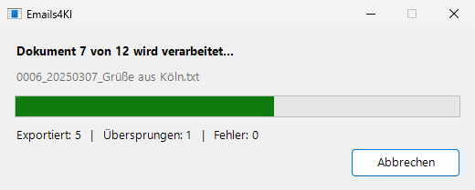
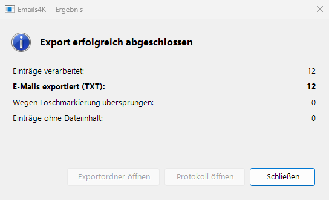

# Emails4KI – Anwenderanleitung

*E-Mails aus enaio als Textdateien exportieren*

## ↗ Überblick

**Emails4KI** ist ein Zusatzprogramm im enaio® Client. Es wandelt markierte E-Mails in einfache Textdateien um. Diese dienen als Stilvorlage für einen Skill in der meinGPT-Plattform.

## ↗ Schritt-für-Schritt-Anleitung

### 1. E-Mails markieren

1. In der enaio-Trefferliste die gewünschten E-Mails markieren (mehrere sind möglich).
1. Keine Ordner oder Register markieren – nur die E-Mails selbst.

### 2. Zusatzprogramm starten

1. Emails4KI im enaio Client über das Zusatzprogramm-Menü aufrufen.
1. Ein Fortschrittsfenster zeigt den aktuellen Stand. Über **Abbrechen** kann der Export gestoppt werden.

*Fortschrittsfenster während der Verarbeitung*

### 3. Ergebnis prüfen

- Der Ergebnisdialog zeigt Anzahl exportierter, übersprungener und fehlerhafter Mails.
- Mit **Exportordner öffnen** oder **Protokoll öffnen** gelangen Sie direkt zu den Dateien.
- Die Option „Exportordner beim Schließen automatisch öffnen“ ist voreingestellt.

> **Hinweis:** Als gelöscht markierte Mails sowie in enaio zum Löschen vorgemerkte Mails werden bewusst **übersprungen**.

*Ergebnisdialog nach Abschluss des Exports*

### 4. Textdateien verwenden

- Ablage unter `Downloads\enaio_export\Export_Datum_Uhrzeit`.
- Dateiname: `0001_20250307_Betreff.txt`.
- Inhalt: Von, An, Cc, Datum, Betreff und Text. Anhänge werden nicht übernommen.

## ↗ Häufige Fragen (FAQ)

**Es erscheint „Keine Dokumente ausgewählt“.**

Bitte zuerst E-Mails in der Trefferliste markieren und das Programm erneut starten.

**Eine Mail fehlt im Ergebnis.**

Sie war vermutlich als gelöscht markiert, zum Löschen vorgemerkt oder hatte keinen Dateiinhalt. Details stehen im Ergebnisdialog.

**Eine Mail wurde nicht umgewandelt.**

Das Original liegt dann im Unterordner `_fehler` des Laufordners und ist im Ergebnisdialog aufgeführt.

**Werden Anhänge exportiert?**

Nein, nur der Mailtext mit Kopfzeilen.

---
VolkswagenStiftung · Emails4KI – Anwenderanleitung · Stand: November 2026
