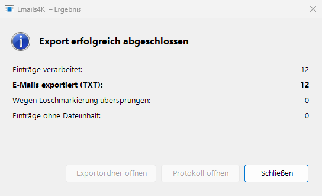

# Emails4KI – IT- und Betriebsanleitung

*Installation, Konfiguration und Fehlersuche*


## ↗ Überblick

Emails4KI ist ein .NET-10-WinForms-Zusatzprogramm (`Emails4KI.exe`) für den enaio® Client. Es liest die markierten Objekte über die COM-API, kopiert die Mails in einen Arbeitsordner und schreibt UTF-8-Textdateien. Outlook ist nicht erforderlich (.eml: MimeKit, .msg: MsgReader).


## ↗ Installation & Betrieb


### 1. Voraussetzungen

- .NET 10 Desktop Runtime (Windows) auf dem Client.
- enaio® Client mit Zusatzprogramm-Konfiguration; Objekt-IDs werden per Parameter übergeben.


### 2. Bereitstellen

- Inhalt von `bin\Release\net10.0-windows` auf den Client oder eine Freigabe kopieren.
- `Emails4KI.json` liegt neben der EXE und wird beim Start geladen.


> **Hinweis:** Konfiguration ändern: Datei anpassen und das Zusatzprogramm neu starten. Backslashes in JSON verdoppeln (`\\`).


### 3. Konfiguration (Emails4KI.json)


| Schlüssel | Bedeutung |
|---|---|
| ExportPath | Basisordner (Standard %USERPROFILE%\Downloads\enaio_export) |
| RunFolderPattern | Muster des Laufordners (Export_yyyyMMdd_HHmmss) |
| DeleteFlagField | Fachliches Löschfeld (zahl1) |
| DeleteFlagFieldByType | Abweichendes Löschfeld je Objekttyp-ID |
| CheckSystemDeleteFlag | enaio-Löschvormerkung prüfen |
| MaxFileNameLength | Maximale Dateinamenlänge (empfohlen 140) |
| Utf8Bom | UTF-8 mit BOM schreiben |
| AutoOpenExportFolders | Vorbelegung: Ordner nach Export öffnen |
| FileLogging.Directory / RetentionDays | Logordner und Aufbewahrung (30 Tage) |


> **Hinweis:** Alle Werte lassen sich per Umgebungsvariable mit Präfix `EMAILS4KI_` überschreiben, z. B. `EMAILS4KI_FileLogging__Directory`.


### 4. Protokoll & Fehlersuche

- Logdatei: `%LOCALAPPDATA%\Emails4KI\Logs\Emails4KI-JJJJ-MM-TT.log`.
- Log-Level über `Logging:LogLevel:Default` (Standard Information).
- Rückgabecodes: 0 = ok, 1 = Dokumentfehler, 2 = kritischer Fehler.
- Fehlerhafte Originale: `Laufordner\_fehler`; `_work` wird immer entfernt.




*Ergebnisdialog nach Abschluss des Exports*


### 5. Build & Tests


```powershell
dotnet build Emails4KI.sln -c Release
dotnet run --project tests\Emails4KI.Tests\Emails4KI.Tests.csproj -c Release
```


## ↗ Häufige Fragen (FAQ)


**Wo finde ich Details zu einem Fehlerlauf?**

Im Tagesprotokoll im Logordner sowie im Ergebnisdialog (Schaltfläche „Protokoll öffnen“).


**Wie wird ein anderes Löschfeld je Archiv gesetzt?**

Über `DeleteFlagFieldByType`, z. B. `{ "65537": "zahl2" }`.


**Wie ist der Ablauf grafisch dargestellt?**

Siehe README.md bzw. `Programmablauf.svg` und `Programmablauf_Uebersicht.svg`.


---
VolkswagenStiftung · Emails4KI – IT- und Betriebsanleitung · Stand: November 2026
