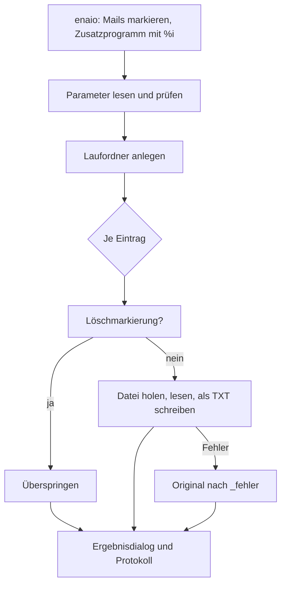

# Projektplan Emails4KI

Stand: November 2026 · Rückwirkend nach dem Phasenmodell des Skills `readme-standard` angelegt und mit dem tatsächlichen Stand (Version 1.0.1) abgeglichen.

## 1. Ziel und Zielgruppe

- **Was:** Zusatzprogramm für den enaio® Client, das markierte E-Mails als schlanke UTF-8-Textdateien exportiert.
- **Für wen:** Anwender:innen, die E-Mails in meinGPT (KI) auswerten wollen.
- **Wozu:** Mails ohne Anhänge, Signaturballast und Dateiformatprobleme als reinen Text bereitstellen. Outlook ist nicht nötig.

## 2. Eingabe und Ausgabe

| | |
| :--- | :--- |
| **Eingabe** | `%i`-Datei aus enaio (eine Zeile je Eintrag `ID,Typ`). Ohne Parameter: aktuelle Markierung per `GetCurrentSelection`. |
| **Mailformate** | `.eml` und `.ima` (ältere enaio-Mails, RFC 822) über MimeKit, `.msg` über MsgReader |
| **Ausgabe** | Je Mail eine Datei `Nr_Datum_Betreff.txt` im Laufordner `Mailexport_yyyyMMdd_HHmmss` |
| **Rückgabecodes** | `0` ok, `1` mindestens ein Dokument fehlgeschlagen, `2` kritischer Fehler |

## 3. Ablauf

1. enaio-Verbindung herstellen, Parameter bzw. Markierung lesen und parsen (Duplikate und ungültige Zeilen werden gezählt).
2. Laufordner anlegen, je Eintrag Dateien über `GetFilesFromIDEx` holen.
3. Löschmarkierungen prüfen (Feld je Archiv/Typ und enaio-Löschvormerkung), Ordner und Register melden.
4. Mail in den Arbeitsordner kopieren, lesen, als TXT schreiben. Defekte Originale kommen nach `_fehler`.
5. Ergebnisdialog, Protokoll, optional Exportordner öffnen. Temporäre `%i`-Datei löschen.

## 4. Architektur

| Klasse | Aufgabe |
| :--- | :--- |
| `Program` | Start, Fehlerbehandlung, Rückgabecodes (dünne Hülle) |
| `ExportProgressForm`, `ExportSummaryForm` | WinForms-Oberfläche (Fortschritt, Ergebnis) |
| `ExportRunner` | Kernablauf, Fehlerisolierung je Dokument, Abbruch |
| `IEnaioClient`, `EnaioClient` | COM-Zugriff (`optimal_AS.Application`) hinter Interface, im Test `FakeEnaioClient` |
| `ParameterParser` | `%i`-Datei und Direktübergabe lesen |
| `MailToTextConverter` | `.eml`/`.ima`/`.msg` in Text wandeln |
| `FileNameBuilder` | Dateinamen bereinigen, Kollisionen, Längenbegrenzung |
| `ExportConfig`, `LoggingSettings`, `Logger` | Konfiguration und Protokoll |

## 5. Konfiguration und Logging

- Datei `Emails4KI.json` neben der EXE, Umgebungsvariablen mit Präfix überschreiben sie.
- Schlüssel: `ExportPath`, `RunFolderPattern`, `DeleteFlagField`, `DeleteFlagFieldByType`, `CheckSystemDeleteFlag`, `MaxFileNameLength`, `Utf8Bom`, `AutoOpenExportFolders`.
- Protokoll: `%LOCALAPPDATA%\Emails4KI\Logs`, 30 Tage Aufbewahrung.

## 6. Testplan

- **Offline (Fakes, `dotnet run --project tests\Emails4KI.Tests -c Release`):** Dateinamensregeln, Konfiguration, Laufordnername (Regression `Expor_`), Parameter-Parser für `%i`/`%p`/`%o`/`%f`/`%g`, Konverter, Exportlauf inkl. `.ima`, Löschflags, Fehlerfälle, Abbruch.
- **Live (laufender enaio Client, Markierung nötig):** `-- --live` und `tests\enaio-com-probe.ps1`. Abnahme: Anzahl der TXT entspricht der Anzahl der Markierungen, Log ohne ungeklärte Warnungen.

## 7. Lehren aus dem Projekt (für künftige Projekte)

- COM-Ausgabeparameter bei Late Binding als `null` übergeben (`ref ""` scheitert).
- Datumsmuster: fester Text in Hochkommas (`'Mailexport'_…`), sonst verschwindet das `t`.
- Dateiendung ist kein Mailkriterium: ältere Mails liegen als `.ima` vor.
- Nach jedem Live-Test Anzahl und Log-Warnungen inhaltlich prüfen, nicht nur Exit-Code.

## 8. Offene Punkte

- Keine.
